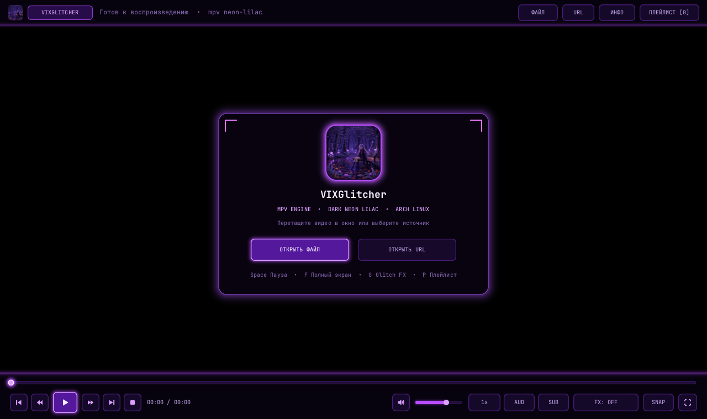
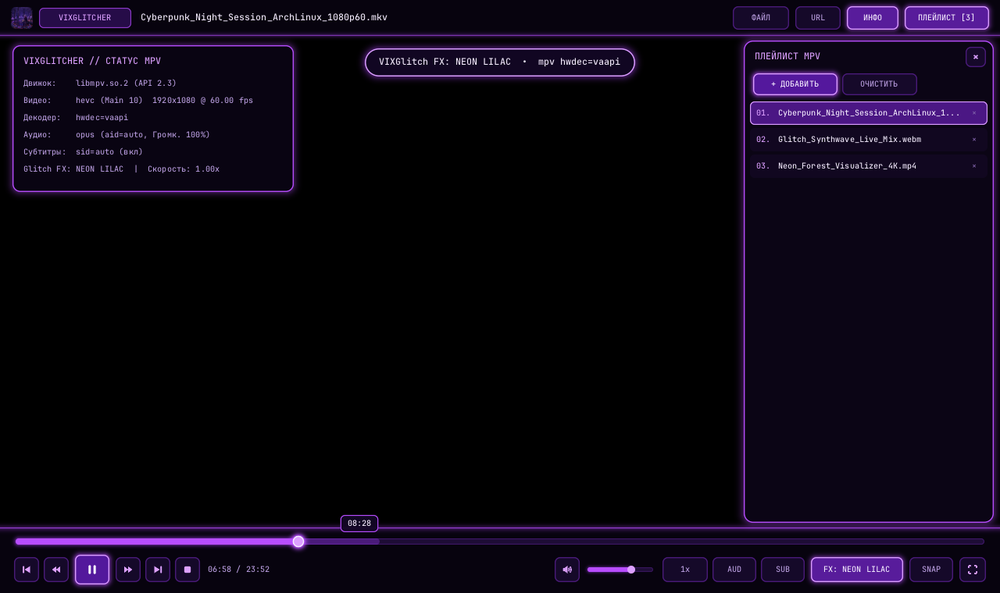

<p align="center">
  
</p>

<h1 align="center">VIXGlitcher</h1>

<p align="center">
  <strong>Нативный видеоплеер под Arch Linux (Wayland &amp; X11) на базе движка <code>mpv</code> (<code>libmpv</code>) в стилистике тёмного неонового сиреневого.</strong><br/>
  <em>Pure Pitch-Black Viewport &bull; Dark Neon Lilac GPU UI &bull; Native <code>x86_64</code> AppImage &bull; Open Source (MIT)</em>
</p>

---

## Скриншоты / Preview

<p align="center">
  
</p>

<p align="center">
  
</p>

---

## Особенности / Features

- **Чистый чёрный фон (`#000000`) и свободное изменение размера окна** — плавно масштабируется от компактного окна (`640×400`) до `4K` / полноэкранного режима, отлично работает как в тайлинговых WM (**Hyprland, Sway, i3, bspwm**), так и в классических DE (**KDE Plasma, GNOME, Xfce**).
- **Полноценный движок `mpv` (`libmpv` OpenGL Render API)** — аппаратное декодирование (`hwdec=auto-safe` — VAAPI / NVDEC / Vulkan), любые форматы (`MKV`, `MP4`, `WebM`, `AVI`, `MOV`, `FLAC`, `MP3`, `HLS/DASH`, онлайн-потоки через `yt-dlp`), субтитры `ASS/SSA/SRT`, переключение аудиодорожек и скорости.
- **Фирменный интерфейс Dark Neon Lilac** — GPU-ускоренный SDF-рендерер с неоновым сиреневым свечением (`#B84DFF` / `#D894FF` / `#E879F9`), автоскрытием панелей при просмотре, встроенным файловым проводником, окном открытия URL и боковой панелью плейлиста.
- **Режим реального времени `VIXGlitch FX`** — встроенные видеофильтры `mpv` по нажатию `G`: `OFF`, `RGB GLITCH`, `NEON LILAC`, `CRT SCAN`, `CYBER BOOST`.
- **Портативный `.AppImage` (FUSE3 static Type-2 runtime)** — работает на современном Arch Linux из коробки без устаревшего `fuse2` и без конфликтов `libstdc++` / Mesa драйверов.

---

## Установка и запуск на Arch Linux

### 1. Требуемый системный пакет `mpv`

На Arch Linux убедитесь, что установлен `mpv` (он предоставляет `libmpv.so.2` и аппаратные декодеры):

```bash
sudo pacman -S mpv
```

*(Опционально для потокового видео по ссылкам: `sudo pacman -S yt-dlp`)*

### 2. Запуск готового `.AppImage` (из раздела [Releases](../../releases))

```bash
chmod +x VIXGlitcher-x86_64.AppImage
./VIXGlitcher-x86_64.AppImage
```

Также можно сразу передать видеофайл или ссылку:

```bash
./VIXGlitcher-x86_64.AppImage ~/Videos/movie.mkv
```

### 3. Нативная сборка пакета Arch Linux (`PKGBUILD`)

```bash
cd packaging/arch
makepkg -si
```

---

## Горячие клавиши (`mpv`-совместимые)

| Клавиша | Действие |
|---|---|
| `Space` / `K` / ЛКМ | Пауза / Воспроизведение |
| `F` / `F11` / Двойной клик | Полноэкранный режим (`Esc` — выход) |
| `Ctrl+O` / `O` | Открыть встроенный проводник файлов |
| `Ctrl+U` | Открыть поток / URL (`Ctrl+V` для вставки) |
| `←` / `→` | Перемотка `-5 сек` / `+5 сек` (`Shift`: `±1с`, `Ctrl`: `±30с`) |
| `↑` / `↓` / Колесо мыши | Громкость `+5%` / `-5%` (до `150%`) |
| `M` | Выключить / включить звук (Mute) |
| `[` / `]` / `Backspace` | Скорость `-0.1x` / `+0.1x` / сброс `1.0x` |
| `.` / `,` | Покадровый шаг вперёд / назад |
| `A` | Переключить аудиодорожку |
| `J` / `V` | Переключить субтитры / скрыть субтитры (ПКМ по `SUB` — загрузить `.srt`/`.ass`) |
| `G` | Переключить видеоэффект **VIXGlitch FX** |
| `S` | Сохранить скриншот кадра в `~/Pictures/VIXGlitcher/` |
| `L` | Повтор отрезка `A–B` (`ab-loop`) |
| `P` | Открыть / скрыть панель плейлиста |
| `I` / `Tab` | Показать техническую панель статуса `mpv` |
| `Q` / `Ctrl+Q` | Выход |

Пользовательский конфиг `mpv` (по желанию) автоматически подхватывается из `~/.config/vixglitcher/mpv.conf`.

---

## Сборка из исходного кода (Open Source)

Зависимости для сборки на Arch Linux:

```bash
sudo pacman -S base-devel sdl2 mpv squashfs-tools
```

Сборка бинарника:

```bash
make
./build/vixglitcher
```

Сборка `.AppImage`:

```bash
./scripts/build-appimage.sh
```

---

## Лицензия / License

Открытый исходный код под лицензией [MIT License](LICENSE).
